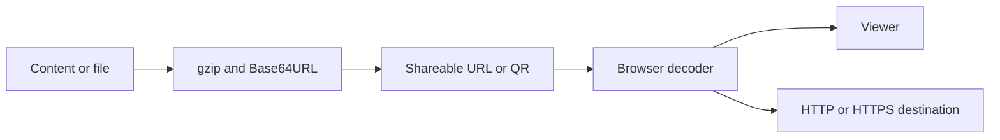

# Application Architecture

Static app for creating and sharing URL-based content: HTML, Markdown, tables, media, jobs, portfolios, link pages and link-based conversations. Data can travel compressed in the link itself. This repository has no persistence API, authenticated account system or slug database.

## Implemented behavior

Next.js 15 Pages Router, React 19, TypeScript 5.7 and styled-components 6. output: export generates out/. Pako compresses, Marked parses Markdown, PapaParse/XLSX read tables, Mammoth reads DOCX, JSZip handles archives and qrcode generates codes. src/pages contains entries; features, entities, widgets and shared separate UI and utilities.

## Related files

- [next.config.js](https://github.com/Vidigal-code/git-page-link-create/blob/809f77e8fe2bd6c78a223db28a4c5e42973a0d91/next.config.js)
- [src/shared/lib/compression.ts](https://github.com/Vidigal-code/git-page-link-create/blob/809f77e8fe2bd6c78a223db28a4c5e42973a0d91/src/shared/lib/compression.ts)
- [src/shared/lib/shorturl/shorturl.ts](https://github.com/Vidigal-code/git-page-link-create/blob/809f77e8fe2bd6c78a223db28a4c5e42973a0d91/src/shared/lib/shorturl/shorturl.ts)
- [src/pages/404.tsx](https://github.com/Vidigal-code/git-page-link-create/blob/809f77e8fe2bd6c78a223db28a4c5e42973a0d91/src/pages/404.tsx)
- [src/pages/create.tsx](https://github.com/Vidigal-code/git-page-link-create/blob/809f77e8fe2bd6c78a223db28a4c5e42973a0d91/src/pages/create.tsx)
- [src/pages/render/index.tsx](https://github.com/Vidigal-code/git-page-link-create/blob/809f77e8fe2bd6c78a223db28a4c5e42973a0d91/src/pages/render/index.tsx)
- [src/pages/shorturl.tsx](https://github.com/Vidigal-code/git-page-link-create/blob/809f77e8fe2bd6c78a223db28a4c5e42973a0d91/src/pages/shorturl.tsx)
- [.github/workflows/deploy.yml](https://github.com/Vidigal-code/git-page-link-create/blob/809f77e8fe2bd6c78a223db28a4c5e42973a0d91/.github/workflows/deploy.yml)
- [src/features/shorturl/model/createCandidates.ts](https://github.com/Vidigal-code/git-page-link-create/blob/809f77e8fe2bd6c78a223db28a4c5e42973a0d91/src/features/shorturl/model/createCandidates.ts)

## Navigation

- [Project guide](?menu=en&lang=en&id=9)
- [Source reference](?menu=en&lang=en&id=10)
