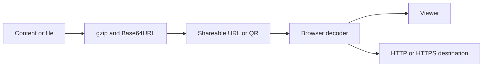

# git-page-link-create: Project context and workflows

GitPageDocs **0.0.25** · 1.0.0 · 2026-11-08

## Context

Static app for creating and sharing URL-based content: HTML, Markdown, tables, media, jobs, portfolios, link pages and link-based conversations. Data can travel compressed in the link itself. This repository has no persistence API, authenticated account system or slug database.

## Stack and architecture

Next.js 15 Pages Router, React 19, TypeScript 5.7 and styled-components 6. output: export generates out/. Pako compresses, Marked parses Markdown, PapaParse/XLSX read tables, Mammoth reads DOCX, JSZip handles archives and qrcode generates codes. src/pages contains entries; features, entities, widgets and shared separate UI and utilities.



## End-to-end workflows

1. /create accepts content or a file → validates format → converts to text/bytes → gzip and Base64URL → render URL. /render, /render-all, /r and /ra recover payloads; image, audio, video, PDF and Office routes select their viewers. Linked pages/utilities define each format's parameters.

2. /shorturl-create reversibly encodes a URL. AT2 uses a prefix dictionary, gzip and Base64URL; AT1/AT0 are legacy decimal formats. The decoder rejects non-HTTP/HTTPS destinations. /shorturl reads c/code, hash or path; the 404 fallback recovers deep paths on static hosting. Navigation occurs in the browser, without an API HTTP 302. Compression does not always produce a shorter URL.

3. /create-jobs, /create-portfolio and /create-links collect data and generate HTML with a shareable link. /chat-link keeps a local transcript serialized as v:1/messages and compressed in #d=chat-; new messages require sharing the new snapshot. This page has no chat server or WhatsApp integration. A QR code only represents the URL.

4. buildShortUrlCandidates also generates refcodes, removes duplicate links and sorts by length. Path transport is limited to codes up to 1500 characters; hash transport is available. In instantRenderer mode, a refcode representing a local path may open the renderer directly. The resolver recognizes AT tokens and refcodes.

## Data, security and limitations

Base64URL/gzip do not encrypt data. Do not put credentials or confidential data in links. Third-party HTML, documents and URLs are untrusted input; isolation depends on the renderer and must be reviewed before handling sensitive content. The codec payload limit is 999,999 bytes; browsers, messengers and hosts can impose lower URL limits. Remote requests depend on availability and CORS. The production base path is /git-page-link-create.

## Setup, testing and operations

Install with pnpm and pnpm-lock.yaml; use dev for development and build for export. Run test, lint and type-check separately: next.config.js allows lint/type errors during builds. Existing export/deploy scripts still use next export, removed in Next.js 14; use build, which already honors output: export. Check Unicode, malformed payloads, deep links, large files and offline rendering. This documentation update does not change deploy.yml or publish the app or GitPageDocs.

## Complete reference

Dependencies, commands, endpoints, variables, contracts and tests are in the [source reference](?menu=en&lang=en&id=10).

## Verifiable sources

- [next.config.js](https://github.com/Vidigal-code/git-page-link-create/blob/809f77e8fe2bd6c78a223db28a4c5e42973a0d91/next.config.js)

- [src/shared/lib/compression.ts](https://github.com/Vidigal-code/git-page-link-create/blob/809f77e8fe2bd6c78a223db28a4c5e42973a0d91/src/shared/lib/compression.ts)

- [src/shared/lib/shorturl/shorturl.ts](https://github.com/Vidigal-code/git-page-link-create/blob/809f77e8fe2bd6c78a223db28a4c5e42973a0d91/src/shared/lib/shorturl/shorturl.ts)

- [src/pages/404.tsx](https://github.com/Vidigal-code/git-page-link-create/blob/809f77e8fe2bd6c78a223db28a4c5e42973a0d91/src/pages/404.tsx)

- [src/pages/create.tsx](https://github.com/Vidigal-code/git-page-link-create/blob/809f77e8fe2bd6c78a223db28a4c5e42973a0d91/src/pages/create.tsx)

- [src/pages/render/index.tsx](https://github.com/Vidigal-code/git-page-link-create/blob/809f77e8fe2bd6c78a223db28a4c5e42973a0d91/src/pages/render/index.tsx)

- [src/pages/shorturl.tsx](https://github.com/Vidigal-code/git-page-link-create/blob/809f77e8fe2bd6c78a223db28a4c5e42973a0d91/src/pages/shorturl.tsx)

- [.github/workflows/deploy.yml](https://github.com/Vidigal-code/git-page-link-create/blob/809f77e8fe2bd6c78a223db28a4c5e42973a0d91/.github/workflows/deploy.yml)

- [src/features/shorturl/model/createCandidates.ts](https://github.com/Vidigal-code/git-page-link-create/blob/809f77e8fe2bd6c78a223db28a4c5e42973a0d91/src/features/shorturl/model/createCandidates.ts)

- [Next.js static export](https://nextjs.org/docs/app/guides/static-exports)

## Documentation navigation with GitPageDocs 0.0.25

The options in this section require the GitPageDocs **0.0.25** runtime. This project's documentation version remains **1.0.0**. Updating text and configuration does not itself update the runtime deployed by the workflow.

### Tag-based contents

In `gitpagedocs/docs/versions/1.0.0/config.json`, each `routes-md` item uses `RouteguideBrand: true` and `RouteGuideTags: ["h1", "h2", "h3"]`. The contents list includes the first three heading levels; other headings remain in the document. Property names are case-sensitive.

```json
{ "RouteguideBrand": true, "RouteGuideTags": ["h1", "h2", "h3"] }
```

Omitting `RouteGuideTags` preserves the legacy behavior, from `h1` through `h6`. An empty list (`[]`) removes automatic tag entries; explicit markers configured in `markdownMarkers.items` can still populate the contents list.

To include other elements, add tag names allowed by the sanitizer, such as `"p"`, `"blockquote"`, `"pre"`, `"table"`, `"img"`, `"details"` or `"summary"`. There is no wildcard: `"*"`, dangerous tags and invalid entries are ignored with a diagnostic. Including `p`, `li`, `div` or `span` may produce many entries; select only tags useful for reading.

Labels use a title, alternative text or element text. Empty elements such as `br`, `hr`, `img` and `input` can use the tag name. Automatic IDs are stable, unique and scoped to each block. Use `markdownMarkers.items` to select an occurrence, supply a custom label or apply a specific highlight.

### Scrolling, small screens and foldables

With contents scrolling unlocked, the active entry is centered, including navigation through Previous/Next. The lock preserves the position selected manually in the contents list. This lets readers inspect another part of the list without automatic tracking repositioning it.

When validating on a phone, check the collapsed menu, touch targets, keyboard focus, tables and horizontally scrollable code blocks. On foldable devices, repeat navigation folded and unfolded, in both orientations, and confirm the active entry remains accessible after the width changes. Use the pause control when animated effects are present and respect reduced-motion preferences.

GitPageDocs 0.0.25 uses `performance.mode: "auto"` for theme effects: it moderately reduces density on desktop and uses a smaller budget below 768px while retaining the theme's layers. Hidden particles pause and resume the same phase when the width changes. To keep full density, merge `site.backgroundEffects.overrides.performance: { "mode": "full" }` into `gitpagedocs/config.json`; the same option is available in `site.backgroundEffects.themes[themeId].performance`. An explicit `layers` override keeps the complete count when no mode is set in the overrides. Select `"auto"` explicitly to apply the budget to custom layers too.

## Fixed theme family and light/dark mode

`HideThemeSelector: true` hides the full theme picker and keeps the family selected by `ThemeDefault`. It still allows light/dark switching when that family has a valid pair. A different theme from the URL or browser storage cannot replace the fixed family.

`ThemeModeDefault` is the initial fallback. A valid mode from `modetheme=light` or `modetheme=dark` in the URL, a saved mode, or the reader’s toggle can select light/dark within that family. The selected mode survives reloads and document navigation. On narrow screens, open Menu to reach the standard control. Without a valid pair, the control is omitted.

Both entries in the layout catalog must enable `supportsLightAndDarkModes`, share the same nonempty `supportsLightAndDarkModesReference`, and declare opposite `mode` values (`light` and `dark`). This project uses the official paired catalog; keep its family and preferences when updating runtime or layout pins.

## Desktop side-guide height

On desktop screens wider than 1024 CSS pixels, the side guide ends after its last entry instead of stretching to the article height. Since 0.0.25, it can grow to the available viewport height below the header before its entries need internal scrolling. This side layout takes precedence over `TocScrollMaxHeightDesktop`; centered guides above the content and layouts at 1024 pixels and below retain their previous sizing rules. A small bar in the active entry's theme color follows the section marked while scrolling. The indicator uses the existing section tracking without continuous animation.
