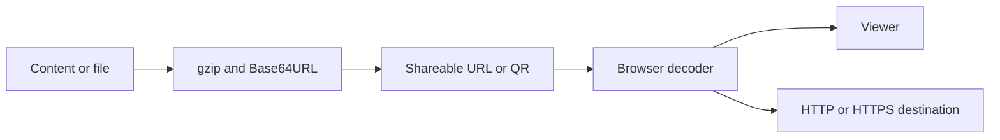

# git-page-link-create: Project context and workflows

GitPageDocs **0.0.17** · 1.0.0 · 2026-10-29

## Context

Static app for creating and sharing URL-based content: HTML, Markdown, tables, media, jobs, portfolios, link pages and link-based conversations. Data can travel compressed in the link itself. This repository has no persistence API, authenticated account system or slug database.

## Stack and architecture

Next.js 15 Pages Router, React 19, TypeScript 5.7 and styled-components 6. output: export generates out/. Pako compresses, Marked parses Markdown, PapaParse/XLSX read tables, Mammoth reads DOCX, JSZip handles archives and qrcode generates codes. src/pages contains entries; features, entities, widgets and shared separate UI and utilities.

## End-to-end workflows

1. /create accepts content or a file → validates format → converts to text/bytes → gzip and Base64URL → render URL. /render, /render-all, /r and /ra recover payloads; image, audio, video, PDF and Office routes select their viewers. Linked pages/utilities define each format's parameters.

2. /shorturl-create reversibly encodes a URL. AT2 uses a prefix dictionary, gzip and Base64URL; AT1/AT0 are legacy decimal formats. The decoder rejects non-HTTP/HTTPS destinations. /shorturl reads c/code, hash or path; the 404 fallback recovers deep paths on static hosting. Navigation occurs in the browser, without an API HTTP 302. Compression does not always produce a shorter URL.

3. /create-jobs, /create-portfolio and /create-links collect data and generate HTML with a shareable link. /chat-link keeps a local transcript serialized as v:1/messages and compressed in #d=chat-; new messages require sharing the new snapshot. This page has no chat server or WhatsApp integration. A QR code only represents the URL.

4. buildShortUrlCandidates also generates refcodes, removes duplicate links and sorts by length. Path transport is limited to codes up to 1500 characters; hash transport is available. In instantRenderer mode, a refcode representing a local path may open the renderer directly. The resolver recognizes AT tokens and refcodes.

## Data, security and limitations

Base64URL/gzip do not encrypt data. Do not put credentials or confidential data in links. Third-party HTML, documents and URLs are untrusted input; isolation depends on the renderer and must be reviewed before handling sensitive content. The codec payload limit is 999,999 bytes; browsers, messengers and hosts can impose lower URL limits. Remote requests depend on availability and CORS. The production base path is /git-page-link-create.

## Setup, testing and operations

Install with pnpm and pnpm-lock.yaml; use dev for development and build for export. Run test, lint and type-check separately: next.config.js allows lint/type errors during builds. Existing export/deploy scripts still use next export, removed in Next.js 14; use build, which already honors output: export. Check Unicode, malformed payloads, deep links, large files and offline rendering. This documentation update does not change deploy.yml or publish the app or GitPageDocs.

## Complete reference

Dependencies, commands, endpoints, variables, contracts and tests are in the [source reference](?menu=en&lang=en&id=10).

## Verifiable sources

- [next.config.js](https://github.com/Vidigal-code/git-page-link-create/blob/809f77e8fe2bd6c78a223db28a4c5e42973a0d91/next.config.js)

- [src/shared/lib/compression.ts](https://github.com/Vidigal-code/git-page-link-create/blob/809f77e8fe2bd6c78a223db28a4c5e42973a0d91/src/shared/lib/compression.ts)

- [src/shared/lib/shorturl/shorturl.ts](https://github.com/Vidigal-code/git-page-link-create/blob/809f77e8fe2bd6c78a223db28a4c5e42973a0d91/src/shared/lib/shorturl/shorturl.ts)

- [src/pages/404.tsx](https://github.com/Vidigal-code/git-page-link-create/blob/809f77e8fe2bd6c78a223db28a4c5e42973a0d91/src/pages/404.tsx)

- [src/pages/create.tsx](https://github.com/Vidigal-code/git-page-link-create/blob/809f77e8fe2bd6c78a223db28a4c5e42973a0d91/src/pages/create.tsx)

- [src/pages/render/index.tsx](https://github.com/Vidigal-code/git-page-link-create/blob/809f77e8fe2bd6c78a223db28a4c5e42973a0d91/src/pages/render/index.tsx)

- [src/pages/shorturl.tsx](https://github.com/Vidigal-code/git-page-link-create/blob/809f77e8fe2bd6c78a223db28a4c5e42973a0d91/src/pages/shorturl.tsx)

- [.github/workflows/deploy.yml](https://github.com/Vidigal-code/git-page-link-create/blob/809f77e8fe2bd6c78a223db28a4c5e42973a0d91/.github/workflows/deploy.yml)

- [src/features/shorturl/model/createCandidates.ts](https://github.com/Vidigal-code/git-page-link-create/blob/809f77e8fe2bd6c78a223db28a4c5e42973a0d91/src/features/shorturl/model/createCandidates.ts)

- [Next.js static export](https://nextjs.org/docs/app/guides/static-exports)
