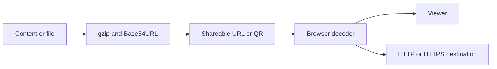

# Arquitectura de la Aplicación

Aplicación estática para crear y compartir contenido en URLs: HTML, Markdown, tablas, medios, empleos, portafolios, páginas de enlaces y conversaciones compartidas. Los datos pueden viajar comprimidos en el enlace. El repositorio no tiene API de persistencia, cuentas autenticadas ni base de slugs.

## Comportamiento implementado

Next.js 15 Pages Router, React 19, TypeScript 5.7 y styled-components 6. output: export genera out/. Pako comprime, Marked interpreta Markdown, PapaParse/XLSX leen tablas, Mammoth lee DOCX, JSZip maneja archivos y qrcode genera códigos. src/pages contiene entradas; features, entities, widgets y shared separan interfaz y utilidades.

## Archivos relacionados

- [next.config.js](https://github.com/Vidigal-code/git-page-link-create/blob/809f77e8fe2bd6c78a223db28a4c5e42973a0d91/next.config.js)
- [src/shared/lib/compression.ts](https://github.com/Vidigal-code/git-page-link-create/blob/809f77e8fe2bd6c78a223db28a4c5e42973a0d91/src/shared/lib/compression.ts)
- [src/shared/lib/shorturl/shorturl.ts](https://github.com/Vidigal-code/git-page-link-create/blob/809f77e8fe2bd6c78a223db28a4c5e42973a0d91/src/shared/lib/shorturl/shorturl.ts)
- [src/pages/404.tsx](https://github.com/Vidigal-code/git-page-link-create/blob/809f77e8fe2bd6c78a223db28a4c5e42973a0d91/src/pages/404.tsx)
- [src/pages/create.tsx](https://github.com/Vidigal-code/git-page-link-create/blob/809f77e8fe2bd6c78a223db28a4c5e42973a0d91/src/pages/create.tsx)
- [src/pages/render/index.tsx](https://github.com/Vidigal-code/git-page-link-create/blob/809f77e8fe2bd6c78a223db28a4c5e42973a0d91/src/pages/render/index.tsx)
- [src/pages/shorturl.tsx](https://github.com/Vidigal-code/git-page-link-create/blob/809f77e8fe2bd6c78a223db28a4c5e42973a0d91/src/pages/shorturl.tsx)
- [.github/workflows/deploy.yml](https://github.com/Vidigal-code/git-page-link-create/blob/809f77e8fe2bd6c78a223db28a4c5e42973a0d91/.github/workflows/deploy.yml)
- [src/features/shorturl/model/createCandidates.ts](https://github.com/Vidigal-code/git-page-link-create/blob/809f77e8fe2bd6c78a223db28a4c5e42973a0d91/src/features/shorturl/model/createCandidates.ts)

## Navegación

- [Project guide](?menu=es&lang=es&id=9)
- [Source reference](?menu=es&lang=es&id=10)
