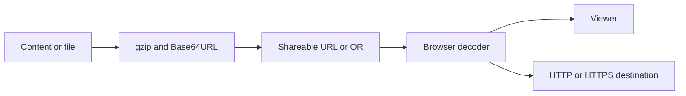

# git-page-link-create: Contexto y flujos del proyecto

GitPageDocs **0.0.17** · 1.0.0 · 2026-10-29

## Contexto

Aplicación estática para crear y compartir contenido en URLs: HTML, Markdown, tablas, medios, empleos, portafolios, páginas de enlaces y conversaciones compartidas. Los datos pueden viajar comprimidos en el enlace. El repositorio no tiene API de persistencia, cuentas autenticadas ni base de slugs.

## Stack y arquitectura

Next.js 15 Pages Router, React 19, TypeScript 5.7 y styled-components 6. output: export genera out/. Pako comprime, Marked interpreta Markdown, PapaParse/XLSX leen tablas, Mammoth lee DOCX, JSZip maneja archivos y qrcode genera códigos. src/pages contiene entradas; features, entities, widgets y shared separan interfaz y utilidades.

## Flujos completos

1. /create recibe contenido o archivo → valida formato → convierte a texto/bytes → gzip y Base64URL → URL de renderizado. /render, /render-all, /r y /ra recuperan el payload; rutas de imagen, audio, vídeo, PDF y Office seleccionan el visor. Las páginas y utilidades enlazadas definen sus parámetros.

2. /shorturl-create codifica la URL reversiblemente. AT2 usa diccionario de prefijos, gzip y Base64URL; AT1/AT0 son formatos decimales antiguos. El decoder rechaza destinos ajenos a HTTP/HTTPS. /shorturl lee c/code, hash o ruta; el fallback 404 recupera rutas profundas. La navegación ocurre en el navegador, sin HTTP 302 de una API. Comprimir no siempre reduce la URL.

3. /create-jobs, /create-portfolio y /create-links recogen datos y generan HTML compartible. /chat-link mantiene transcript local serializado como v:1/messages y comprimido en #d=chat-; mensajes nuevos requieren compartir el nuevo snapshot. No tiene servidor de chat ni integración WhatsApp. Un QR solo representa la URL.

4. buildShortUrlCandidates también genera refcodes, elimina duplicados y ordena por longitud. Transporte por ruta limita códigos a 1500 caracteres; hay alternativa por hash. En instantRenderer un refcode de ruta local puede abrir directamente el renderizador. El resolvedor reconoce AT y refcodes.

## Datos, seguridad y límites

Base64URL/gzip no cifran datos. No incluya credenciales ni información confidencial en enlaces. HTML, documentos y URLs externos son entrada no confiable; el aislamiento depende del renderizador. El codec limita el payload a 999.999 bytes; navegador, mensajería y hosting pueden imponer límites menores. Solicitudes remotas dependen de disponibilidad y CORS. La base de producción es /git-page-link-create.

## Ejecución, pruebas y operación

Instale con pnpm y pnpm-lock.yaml; use dev para desarrollo y build para exportar. Ejecute test, lint y type-check por separado: next.config.js permite errores de lint/tipos durante el build. export/deploy todavía usan next export, eliminado en Next.js 14; use build con output: export. Compruebe Unicode, payload inválido, rutas profundas, archivos grandes y renderizado sin red. Esta actualización no cambia deploy.yml ni publica la aplicación o GitPageDocs.

## Referencia completa

Dependencias, comandos, endpoints, variables, contratos y pruebas están en la [referencia del código](?menu=es&lang=es&id=10).

## Fuentes verificables

- [next.config.js](https://github.com/Vidigal-code/git-page-link-create/blob/809f77e8fe2bd6c78a223db28a4c5e42973a0d91/next.config.js)

- [src/shared/lib/compression.ts](https://github.com/Vidigal-code/git-page-link-create/blob/809f77e8fe2bd6c78a223db28a4c5e42973a0d91/src/shared/lib/compression.ts)

- [src/shared/lib/shorturl/shorturl.ts](https://github.com/Vidigal-code/git-page-link-create/blob/809f77e8fe2bd6c78a223db28a4c5e42973a0d91/src/shared/lib/shorturl/shorturl.ts)

- [src/pages/404.tsx](https://github.com/Vidigal-code/git-page-link-create/blob/809f77e8fe2bd6c78a223db28a4c5e42973a0d91/src/pages/404.tsx)

- [src/pages/create.tsx](https://github.com/Vidigal-code/git-page-link-create/blob/809f77e8fe2bd6c78a223db28a4c5e42973a0d91/src/pages/create.tsx)

- [src/pages/render/index.tsx](https://github.com/Vidigal-code/git-page-link-create/blob/809f77e8fe2bd6c78a223db28a4c5e42973a0d91/src/pages/render/index.tsx)

- [src/pages/shorturl.tsx](https://github.com/Vidigal-code/git-page-link-create/blob/809f77e8fe2bd6c78a223db28a4c5e42973a0d91/src/pages/shorturl.tsx)

- [.github/workflows/deploy.yml](https://github.com/Vidigal-code/git-page-link-create/blob/809f77e8fe2bd6c78a223db28a4c5e42973a0d91/.github/workflows/deploy.yml)

- [src/features/shorturl/model/createCandidates.ts](https://github.com/Vidigal-code/git-page-link-create/blob/809f77e8fe2bd6c78a223db28a4c5e42973a0d91/src/features/shorturl/model/createCandidates.ts)

- [Next.js static export](https://nextjs.org/docs/app/guides/static-exports)
