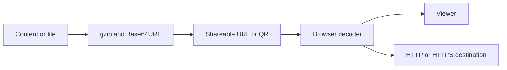

# Arquitetura da Aplicação

Aplicação estática para criar e compartilhar conteúdo em URLs: HTML, Markdown, tabelas, mídia, vagas, portfólios, páginas de links e conversas compartilhadas por link. Os dados podem viajar compactados no próprio link. Não existe API de persistência, conta autenticada ou banco de slugs neste repositório.

## Comportamento implementado

Next.js 15 com Pages Router, React 19, TypeScript 5.7 e styled-components 6. O build usa output: export e gera out/. Pako comprime, Marked interpreta Markdown, PapaParse/XLSX leem tabelas, Mammoth interpreta DOCX, JSZip trabalha com arquivos compactados e qrcode gera códigos. src/pages contém entradas; features, entities, widgets e shared separam interface e utilitários.

## Arquivos relacionados

- [next.config.js](https://github.com/Vidigal-code/git-page-link-create/blob/809f77e8fe2bd6c78a223db28a4c5e42973a0d91/next.config.js)
- [src/shared/lib/compression.ts](https://github.com/Vidigal-code/git-page-link-create/blob/809f77e8fe2bd6c78a223db28a4c5e42973a0d91/src/shared/lib/compression.ts)
- [src/shared/lib/shorturl/shorturl.ts](https://github.com/Vidigal-code/git-page-link-create/blob/809f77e8fe2bd6c78a223db28a4c5e42973a0d91/src/shared/lib/shorturl/shorturl.ts)
- [src/pages/404.tsx](https://github.com/Vidigal-code/git-page-link-create/blob/809f77e8fe2bd6c78a223db28a4c5e42973a0d91/src/pages/404.tsx)
- [src/pages/create.tsx](https://github.com/Vidigal-code/git-page-link-create/blob/809f77e8fe2bd6c78a223db28a4c5e42973a0d91/src/pages/create.tsx)
- [src/pages/render/index.tsx](https://github.com/Vidigal-code/git-page-link-create/blob/809f77e8fe2bd6c78a223db28a4c5e42973a0d91/src/pages/render/index.tsx)
- [src/pages/shorturl.tsx](https://github.com/Vidigal-code/git-page-link-create/blob/809f77e8fe2bd6c78a223db28a4c5e42973a0d91/src/pages/shorturl.tsx)
- [.github/workflows/deploy.yml](https://github.com/Vidigal-code/git-page-link-create/blob/809f77e8fe2bd6c78a223db28a4c5e42973a0d91/.github/workflows/deploy.yml)
- [src/features/shorturl/model/createCandidates.ts](https://github.com/Vidigal-code/git-page-link-create/blob/809f77e8fe2bd6c78a223db28a4c5e42973a0d91/src/features/shorturl/model/createCandidates.ts)

## Navegação

- [Project guide](?menu=pt&lang=pt&id=9)
- [Source reference](?menu=pt&lang=pt&id=10)
