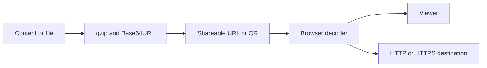

# git-page-link-create: Contexto e fluxos do projeto

GitPageDocs **0.0.17** · 1.0.0 · 2026-10-29

## Contexto

Aplicação estática para criar e compartilhar conteúdo em URLs: HTML, Markdown, tabelas, mídia, vagas, portfólios, páginas de links e conversas compartilhadas por link. Os dados podem viajar compactados no próprio link. Não existe API de persistência, conta autenticada ou banco de slugs neste repositório.

## Stack e arquitetura

Next.js 15 com Pages Router, React 19, TypeScript 5.7 e styled-components 6. O build usa output: export e gera out/. Pako comprime, Marked interpreta Markdown, PapaParse/XLSX leem tabelas, Mammoth interpreta DOCX, JSZip trabalha com arquivos compactados e qrcode gera códigos. src/pages contém entradas; features, entities, widgets e shared separam interface e utilitários.

## Fluxos completos

1. /create recebe conteúdo ou arquivo → valida o formato → converte para texto ou bytes → gzip e Base64URL → URL de renderização. /render, /render-all, /r e /ra recuperam o payload; rotas de imagem, áudio, vídeo, PDF e Office escolhem a visualização apropriada. Consulte as páginas e utilitários vinculados para os parâmetros específicos de cada formato.

2. /shorturl-create codifica a URL reversivelmente. O token AT2 usa dicionário de prefixos, gzip e Base64URL; AT1/AT0 são formatos decimais legados. O decoder rejeita destinos fora de HTTP/HTTPS. /shorturl lê c/code, hash ou caminho; o fallback 404 recupera caminhos profundos no hosting estático. A navegação ocorre no navegador, sem resposta HTTP 302 de uma API. Compressão não garante URL menor em todos os casos.

3. /create-jobs, /create-portfolio e /create-links coletam dados e geram HTML com link compartilhável. /chat-link mantém uma conversa local (transcript) serializada em payload v:1/messages e compactada no hash #d=chat-; novas mensagens exigem compartilhar o novo snapshot. Não há servidor de chat nem integração WhatsApp nessa página. QR Code apenas representa a URL.

4. buildShortUrlCandidates também gera refcodes, elimina links repetidos e ordena pelo comprimento. Transporte por caminho é limitado a códigos de até 1500 caracteres; há alternativa por hash. No modo instantRenderer, um refcode que representa caminho local pode abrir diretamente o renderizador. O resolvedor reconhece tokens AT e refcodes.

## Dados, segurança e limites

Base64URL/gzip não criptografam dados. Não coloque credenciais ou informação confidencial em links. HTML, documentos e URLs de terceiros são entrada não confiável; o comportamento de isolamento depende do renderizador e deve ser revisado antes de aceitar conteúdo sensível. O limite de payload do codec é 999.999 bytes; navegador, mensageiro e hospedagem podem impor limites menores à URL. Requisições remotas dependem de disponibilidade e CORS. O caminho de produção é /git-page-link-create.

## Execução, testes e operação

Instale com pnpm usando pnpm-lock.yaml; use dev para desenvolvimento e build para exportação. Rode test, lint e type-check separadamente: next.config.js permite erros de lint/tipos durante o build. Os scripts export/deploy ainda usam next export, removido no Next.js 14; use build, que já respeita output: export. Verifique Unicode, payload inválido, links profundos, arquivos grandes e renderização sem rede. A atualização desta documentação não altera o workflow deploy.yml, não publica o app e não publica o GitPageDocs.

## Referência completa

Dependências, comandos, endpoints, variáveis, contratos e testes estão na [referência do código](?menu=pt&lang=pt&id=10).

## Fontes verificáveis

- [next.config.js](https://github.com/Vidigal-code/git-page-link-create/blob/809f77e8fe2bd6c78a223db28a4c5e42973a0d91/next.config.js)

- [src/shared/lib/compression.ts](https://github.com/Vidigal-code/git-page-link-create/blob/809f77e8fe2bd6c78a223db28a4c5e42973a0d91/src/shared/lib/compression.ts)

- [src/shared/lib/shorturl/shorturl.ts](https://github.com/Vidigal-code/git-page-link-create/blob/809f77e8fe2bd6c78a223db28a4c5e42973a0d91/src/shared/lib/shorturl/shorturl.ts)

- [src/pages/404.tsx](https://github.com/Vidigal-code/git-page-link-create/blob/809f77e8fe2bd6c78a223db28a4c5e42973a0d91/src/pages/404.tsx)

- [src/pages/create.tsx](https://github.com/Vidigal-code/git-page-link-create/blob/809f77e8fe2bd6c78a223db28a4c5e42973a0d91/src/pages/create.tsx)

- [src/pages/render/index.tsx](https://github.com/Vidigal-code/git-page-link-create/blob/809f77e8fe2bd6c78a223db28a4c5e42973a0d91/src/pages/render/index.tsx)

- [src/pages/shorturl.tsx](https://github.com/Vidigal-code/git-page-link-create/blob/809f77e8fe2bd6c78a223db28a4c5e42973a0d91/src/pages/shorturl.tsx)

- [.github/workflows/deploy.yml](https://github.com/Vidigal-code/git-page-link-create/blob/809f77e8fe2bd6c78a223db28a4c5e42973a0d91/.github/workflows/deploy.yml)

- [src/features/shorturl/model/createCandidates.ts](https://github.com/Vidigal-code/git-page-link-create/blob/809f77e8fe2bd6c78a223db28a4c5e42973a0d91/src/features/shorturl/model/createCandidates.ts)

- [Next.js static export](https://nextjs.org/docs/app/guides/static-exports)
